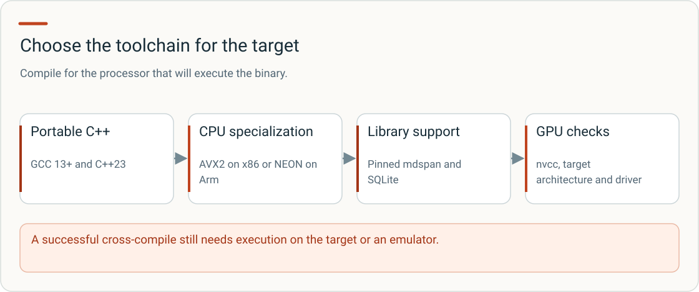

# Getting Started

This book targets modern C++ compiled with `g++` (GCC 13 or newer). Most chapters use nothing beyond C++20/23 as shipped in any current GCC, but two specific areas need an extra toolchain component described below: `std::mdspan` (Part 0) and Arm NEON (Part 2).

<!-- chapter-figure -->
<figure class="chapter-figure" markdown="1">

{: loading="lazy" width="1120" height="470" }

  <figcaption>A successful cross-compile still needs execution on the target or an emulator.</figcaption>
</figure>
<!-- /chapter-figure -->

## The base toolchain

```bash
g++ --version                                   # GCC 13.0 or newer
g++ -std=c++23 -Wall -Wextra -O2 file.cpp -o binary
```

Standalone portable examples use the command above. Examples that create threads should also use `-pthread` on GCC/Linux. SIMD, mdspan, SQLite, POSIX model-loading, and CUDA examples have additional platform or dependency requirements listed below and in their chapters.

On macOS, `g++` usually invokes Apple Clang. Check `g++ --version` before following GCC-specific instructions. The canonical validation scripts target GCC on Linux, and platform-dependent output can differ on other toolchains.

## `std::mdspan`: a vendored reference implementation

`std::mdspan` is standard C++23, but support depends on the standard-library release. The GCC 13/14 setup used for the book requires a separate implementation. This book uses the official Kokkos/mdspan reference implementation instead, the same reference implementation the standard itself was developed from, pinned to a specific commit for reproducibility:

```bash
# From the root of this repository, matching the verification scripts:
git clone https://github.com/kokkos/mdspan.git _vendor_mdspan
git -C _vendor_mdspan checkout 8989f70749e28f337e6f7aa210db88659dba6f2f
```

Compile any file that includes `<mdspan/mdspan.hpp>` with:

```bash
g++ -std=c++23 -Wall -Wextra -O2 \
    -DMDSPAN_IMPL_STANDARD_NAMESPACE=std -DMDSPAN_IMPL_PROPOSED_NAMESPACE=experimental \
    -I_vendor_mdspan/include file.cpp -o binary
```

The two `-D` flags tell the reference implementation to define its types directly in namespace `std` (its default is the non-conflicting `Kokkos` namespace, for codebases that need both an experimental and a future standard version side by side). With them, `std::mdspan`, `std::extents`, and `std::submdspan` in this book's own code are exactly the standard-track API, backed by an implementation that runs correctly today rather than a stub.

This book standardizes on `-std=c++23`, not `-std=c++20`, for every file that touches `std::mdspan` — verified directly rather than assumed. The reference implementation's templates compile fine under `-std=c++20`, but this book's own code leans on `matrix[i, j]`-style multi-argument `operator[]` throughout, and that specific syntax is a C++23 core-language feature (multi-dimensional subscript operators, P2128), not a library feature the reference implementation can backport on its own. Under `-std=c++20` a call like `matrix[1, 2]` still compiles — as a deprecated comma expression that silently discards the `1` and indexes with `2` alone — and then fails with a template error, not a clean rejection, the first time it hits a call whose rank actually requires two indices. `-std=c++23` is what makes `matrix[i, j]` mean what every example in this book needs it to mean.

## SIMD: two real, genuinely-executed paths

- **x86 AVX2** compiles and runs natively on any AVX2-capable machine (nearly all x86-64 hardware from the last decade):

```bash
g++ -std=c++23 -Wall -Wextra -O2 -mavx2 -mfma file.cpp -o binary
./binary
```

- **Arm NEON** is cross-compiled and then genuinely *executed* under user-mode emulation — this book does not stop at "this compiles for Arm," it runs the resulting binary and locks its real output, the same way every other example in this book is verified:

```bash
sudo apt-get install -y g++-aarch64-linux-gnu qemu-user
aarch64-linux-gnu-g++ -std=c++23 -Wall -Wextra -O2 file.cpp -o binary_arm
qemu-aarch64 -L /usr/aarch64-linux-gnu ./binary_arm
```

Both paths produce this book's own locked, verified output — neither is a description of what *should* happen on real hardware.

## SQLite logging (Chapter 18)

The inspection logging example links against SQLite. On the book's Linux setup:

```bash
g++ -std=c++23 -Wall -Wextra -O2 04_disposition_and_logging.cpp \
    -l:libsqlite3.so.0 -o inspection_logging
```

On macOS, link the system library with `-lsqlite3` instead. The Chapter 17 peak-memory examples use Linux `/proc/self/status`; their Linux-specific memory assertions require that environment. Architecture-dependent random-distribution samples and compiler optimizations can also change the illustrative transcripts.

## GPU acceleration (Part 6 only)

Part 6 uses a CUDA toolchain for device code. Chapter 32's attention kernel has been compiled and executed on an A100 with CUDA 12.8. A compiler can also be installed in a separate environment:

```bash
python3 -m venv .venv
. .venv/bin/activate
python -m pip install nvidia-cuda-nvcc-cu13
```

Select the architecture for the GPU that will execute the binary. A100 uses `-arch=sm_80`; Jetson Orin uses `-arch=sm_87`. The NVIDIA driver must be compatible with the toolkit. GPU validation requires a visible physical device.

The Chapter 32 A100 suite checks 60 attention shapes against a CPU reference. NVIDIA Compute Sanitizer's memory, race, and synchronization checks also pass. A no-device run explicitly skips GPU comparisons while retaining host checks.

## The honesty discipline this book follows

- **Plain host C++** is genuinely compiled and genuinely run, natively, every time.
- **Arm NEON code** is genuinely cross-compiled and genuinely run under `qemu-user` emulation — real execution, not a compile-only claim.
- **x86 AVX2 code** is genuinely compiled and genuinely run natively.
- **CUDA attention** (Chapter 32) is compiled and run on an A100, checked against the CPU reference and with Compute Sanitizer. Hosts without a GPU report skipped device comparisons.
- **Timing and throughput numbers are never fabricated.** Where a chapter's argument depends on which of two approaches is faster rather than merely which is correct, this book measures a genuinely computed, deterministic quantity instead of a wall-clock number wherever one exists — an operation count, a byte count, a cache-line count — specifically because a wall-clock number captured once is not reproducible on a rerun, let alone on a reader's own hardware, the way an exact count is. Where genuine wall-clock methodology itself is the topic, this book says so explicitly and separates any genuinely-varying raw number out of its own locked, verified output.

Every chapter states which of the above applies to each piece of its own code, so nothing is left for a reader to guess about how a claim was actually established.

## Compile-line conventions

- Portable C++ host files (`.cpp`): `g++ -std=c++23 -Wall -Wextra -O2 file.cpp -o binary`. Add `-pthread` for threaded examples on GCC/Linux and follow the platform notes above.
- Files using `std::mdspan`: add the two `-D` flags and the `-I` path shown above, and compile with `-std=c++23` — this book's `matrix[i, j]` multi-argument indexing is a C++23 core-language feature, not merely a library one, so `-std=c++20` will not reject it cleanly; it will instead misparse it as a deprecated comma expression.
- x86 SIMD files: add `-mavx2 -mfma` (or the specific instruction-set flag a section calls for).
- Arm NEON files: cross-compiled with `aarch64-linux-gnu-g++`, run with `qemu-aarch64 -L /usr/aarch64-linux-gnu`.
- CUDA files (Part 6): `nvcc -arch=sm_80 file.cu -o binary`, with `-lcudart` and toolchain include/library paths shown inline wherever a file calls the CUDA Runtime API from the host.

## Prerequisites

This book assumes working knowledge of C++ (classes, templates, RAII, move semantics) and does not assume any prior experience with quantization, SIMD intrinsics, or transformer internals — Part 0 builds every piece of vocabulary this book needs from nothing. It does assume basic familiarity with how a transformer's forward pass is structured at a conceptual level (attention, feed-forward layers); Part 0's own Chapter 3 is what turns that into working, compiled C++.
